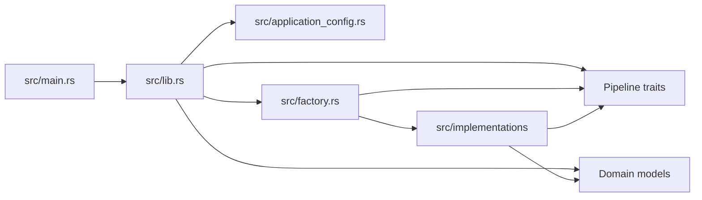
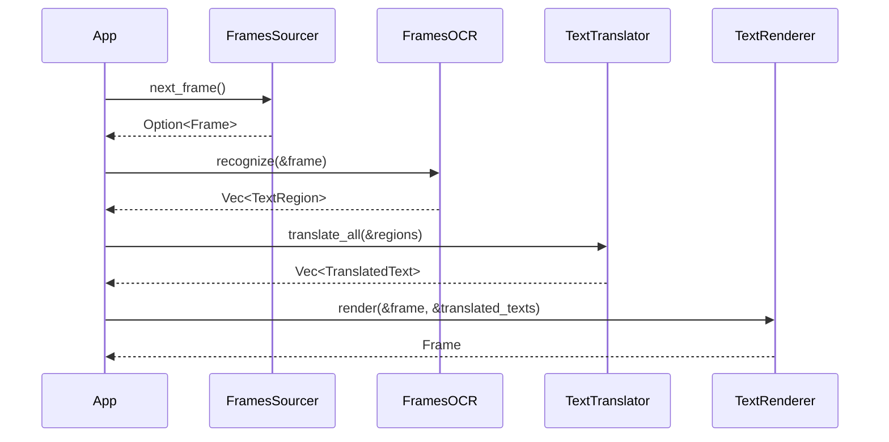
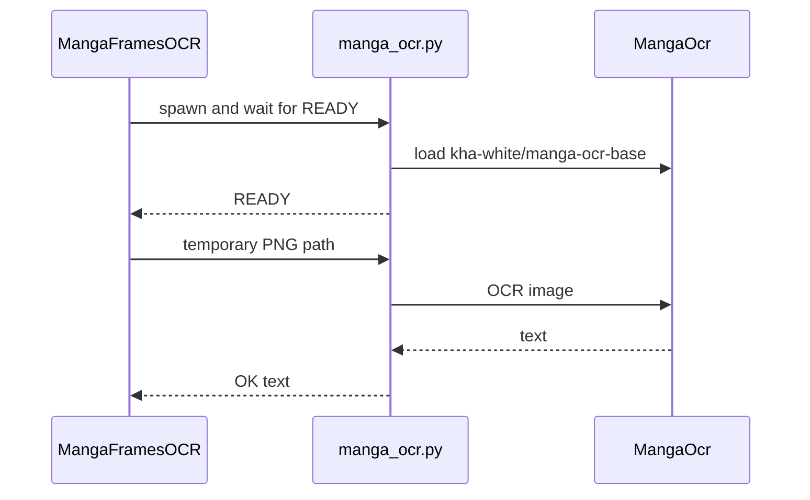

# Architecture

## Purpose

FramesTranslator is structured as a four-stage image translation pipeline:

1. `FramesSourcer` provides RGBA frames.
2. `FramesOCR` finds text regions in a frame.
3. `TextTranslator` translates recognized text.
4. `TextRenderer` draws translated regions onto a new frame.

The current repository provides the contracts, domain models, configuration, implementation factory, deterministic development backends, and integration tests. It does not yet provide production OCR, machine translation, or font rendering.

## Architectural style

The project separates four concerns:

- **Domain models** describe frames and text regions without depending on any backend.
- **Pipeline contracts** are Rust traits with typed errors.
- **Concrete implementations** adapt local resources to those contracts.
- **Composition** loads class names from `ApplicationConfig` and constructs the selected implementations through a factory.

The pipeline depends on traits. Concrete types are known only to the factory, `src/lib.rs`, and tests that intentionally exercise a specific implementation.



## Module layout

| Path | Responsibility |
| --- | --- |
| `src/frame.rs` | Named RGBA `Frame` model and `FrameError` |
| `src/frame_translation.rs` | Context-aware dialog translation and line distribution |
| `src/frames_detector_sourcer.rs` | Abstract `FramesDetectorSourcer` trait, `DetectedFrame`, and shared queue/extraction helpers |
| `src/frames_config.rs` | `FramesConfig` and named frame rectangles |
| `src/tests_config.rs` | `TestsConfig` and per-test configuration structs |
| `src/application_config.rs` | `ApplicationConfig` implementation selection and JSONC methods |
| `src/text_region.rs` | `Bounds`, `TextRegion`, and `TranslatedText` |
| `src/debug_text.rs` | Debug-font text wrapping, fitting, and drawing shared by renderers |
| `src/frames_sourcer.rs` | `FramesSourcer` contract and `FrameSourceError` |
| `src/screenshoter.rs` | `Screenshoter` contract and `ScreenshotError` |
| `src/frames_ocr.rs` | `FramesOCR` contract and `RecognitionError` |
| `src/text_translator.rs` | `TextTranslator` contract and `TranslationError` |
| `src/text_renderer.rs` | `TextRenderer` contract and `RenderingError` |
| `src/factory.rs` | Class-name based composition and `FactoryError` |
| `src/implementations/` | Concrete backends for the four contracts |
| `src/lib.rs` | Public module and re-export surface |
| `src/main.rs` | Binary entry point for the interactive drag-and-drop application |
| `src/sdl_frame_viewer.rs` | Shared SDL3 window, drop-event loop, translucent frame tinting, and frame counter |
| `src/sdl_image_translator.rs` | `FramesTranslator` scene builder with OCR and translation overlays |
| `src/bin/neural_network_frames_detector_sourcer_test_application.rs` | Detector-only SDL application entry point |

## Domain models

### Frame

`Frame` owns a name and a validated RGBA8 pixel buffer.

Invariants:

- Pixel data length equals `width * height * 4`.
- Multiplication overflow is rejected through `FrameError::DimensionsOverflow`.
- A buffer length mismatch is rejected through `FrameError::PixelBufferSizeMismatch`.

The type is immutable through its public read-only accessors. Renderers copy the buffer and return a new `Frame` instead of mutating the input.

### FramesConfig

`FramesConfig` holds a `frames` list of `NamedRect` values. Each `NamedRect` pairs a name with a `Bounds` rectangle. The configuration preserves order and does not perform additional rectangle validation.

### TestsConfig

`TestsConfig` groups a separate configuration struct for each test case. It exposes `ShadowrunCdTestConfig` for the gameplay menus, `ShadowrunDialogTestConfig` for the intro dialog box, `ShadowrunStreetTestConfig` for the Shibuya street dialog box, and `ShadowrunHospitalTestConfig` for the upscaled hospital dialog. Each owns a `FramesConfig` describing the expected detected frames, `BTreeMap` dictionaries of expected OCR lines under `expectedResultOCR` and expected translations under `expectedTranslationResult` keyed by expected frame name, and the renderer preview duration under `timeoutSeconds`. Additional test cases should add their own configuration struct rather than sharing one generic shape.

### Bounds

`Bounds` stores `x`, `y`, `width`, and `height`. `right()` and `bottom()` use saturating addition, so coordinate overflow cannot wrap. Bounds are not clamped to a frame; renderers validate containment before drawing.

### TextRegion and TranslatedText

`TextRegion` pairs recognized text with bounds. `TranslatedText` retains the original region and adds translated text. Retaining the source region lets the renderer preserve position and gives callers access to both the original and translated forms.

## Pipeline contracts

| Contract | Method | Ownership | Termination |
| --- | --- | --- | --- |
| `FramesSourcer` | `next_frame(&mut self) -> Result<Option<Frame>, FrameSourceError>` | Mutable source, owned frame | `None` |
| `Screenshoter` | `sources(&self) -> Result<Vec<String>, ScreenshotError>` and `screenshot(&self, &str) -> Result<Frame, ScreenshotError>` | Shared capturer, owned frame | Selectable source names |
| `FramesOCR` | `recognize(&self, &Frame) -> Result<Vec<TextRegion>, RecognitionError>` | Shared frame | Empty region list |
| `TextTranslator` | `translate(&mut self, &str) -> Result<String, TranslationError>` | Mutable translator | Error for unknown text |
| `TextRenderer` | `render(&self, &Frame, &[TranslatedText]) -> Result<Frame, RenderingError>` | Shared input, new frame | Returns a new frame |

`TextTranslator` also provides a default `translate_all` method that maps each `TextRegion` through `translate` and returns `Vec<TranslatedText>`.

`FramesDetectorSourcer` is an abstract detector contract on top of `FramesSourcer`:

| Contract | Method | Ownership | Result |
| --- | --- | --- | --- |
| `FramesDetectorSourcer` | `detect(&self, &RgbaImage) -> Result<Vec<DetectedFrame>, FrameSourceError>` | Shared image | Detected frames with original bounds |

Concrete detectors implement both `FramesSourcer` and `FramesDetectorSourcer`. The shared `DetectedFrameQueue` and `detected_frames_from_bounds` helpers keep cropping and naming consistent between implementations, while each detector owns its detection algorithm.

The translator takes `&mut self` to allow stateful implementations such as caches or sessions. OCR and rendering take `&self` because they are modeled as read-only operations over their inputs.

`Screenshoter` acquires frames from live windows instead of files. `sources` returns the selectable source names, and `screenshot` captures the named source as an RGBA `Frame` that can be passed to `FramesOCR` directly or converted to an `RgbaImage` for `FramesDetectorSourcer::detect`. It is an input acquisition contract rather than one of the four pipeline stages.

All contracts are object-safe, allowing the factory and application to hold `Box<dyn Trait>` values.

## Data flow



The application owns orchestration. Individual stages do not call each other, which keeps them independently replaceable and testable.

## Configuration and composition

Implementation selection is defined by `ApplicationConfig`. The current test configuration is `test-case/tests-application-config.jsonc`:

```jsonc
{
  "framesSourcer": "NeuralNetworkFramesDetectorSourcer",
  "framesOcr": "MangaFramesOCR",
  "textTranslator": "ArgosTextTranslator",
  "textRenderer": "SdlThreeTextRenderer",
  "framesDetectionBackgroundColors": [0x000000],
  "framesDetectionTextColors": [0xfcfcfc, 0xffffff, 0xfcfcb4],
  "verboseMode": true
}
```

`ApplicationConfig` uses Serde with camelCase field names. `ApplicationConfig::from_jsonc` parses JSONC through `json5`; `ApplicationConfig::to_jsonc` emits pretty JSON through `serde_json`.

`src/factory.rs` is the composition root. Each factory function reads one implementation name from `ApplicationConfig` and constructs the matching implementation:

| Factory function | Configuration getter | Configuration key |
| --- | --- | --- |
| `create_frames_sourcer` | `frames_sourcer()` | `framesSourcer` |
| `create_frames_ocr` | `frames_ocr()` | `framesOcr` |
| `create_text_translator` | `text_translator()` | `textTranslator` |
| `create_text_renderer` | `text_renderer()` | `textRenderer` |

`ImageFramesSourcer` uses the fixed image `test-case/Shadowrun_02.png` and the frame definitions in `test-case/tests-config.jsonc` when created through the factory. The constructor `ImageFramesSourcer::open(path, frames_config)` remains available for explicit image paths and frame definitions.

Both detector implementations use the fixed `Shadowrun_02.png` image when created through `create_frames_sourcer`. `ProceduralFramesDetectorSourcer` reads `framesDetectionBackgroundColors` and `framesDetectionTextColors` from `ApplicationConfig`. Both are arrays of 24-bit RGB integers; JSONC hexadecimal literals such as `0x000000` are accepted. Color values outside `0xFFFFFF` are rejected through `FrameSourceError::InvalidColor`. Integration tests open `Shadowrun_01.png` through `Shadowrun_04.png` directly with the same configured color arrays.

`ProceduralFramesDetectorSourcer` matches a color set when every channel is within a fixed tolerance of any color in that set: 8 for background colors and 32 for text colors. The text tolerance handles upscaled screenshots whose anti-aliased glyphs are gray instead of the configured near-white.

`NeuralNetworkFramesDetectorSourcer` starts a persistent `.venv/Scripts/python.exe` worker with `scripts/neural_frame_detector_worker.py` and does not receive configured colors. The worker proposes candidate regions from the image's dominant colors, computes structural features (normalized size, aspect ratio, fill share, contrast density, and area share), and validates each candidate with a locally trained PyTorch classifier. Both implementations produce two frames for `Shadowrun_02.png` and one frame each for `Shadowrun_01.png`, `Shadowrun_03.png`, and `Shadowrun_04.png`. The same neural detector also finds the beige `Banana_01.png` dialog at `(24, 199, 460, 246)` without any palette configuration. Integration tests validate them against the expected `frames` entries in `test-case/tests-config.jsonc` by order, name prefix, position, dimensions, and crop pixels. OCR and translation expectations are looked up by the expected frame name, so each panel and the dialog box are validated independently.

Because the application configuration remains focused on implementation selection and the two detector colors, other backend-specific settings are constants inside implementations rather than configuration values.

### Configuration serialization

`ApplicationConfig`, `TestsConfig`, and their nested configuration types derive Serde serialization and deserialization. All JSONC entry points use `json5`, which supports comments and trailing commas. Serialization uses `serde_json` and emits pretty JSON. `test-case/tests-application-config.jsonc` and `test-case/tests-config.jsonc` are the serialized representations of the current configurations.

`ShadowrunCdTestConfig` flattens its `FramesConfig`, so the JSONC shape is:

```jsonc
{
  "shadowrun_cd": {
    "frames": [
      {
        "name": "Actions Menu",
        "rect": { "x": 18, "y": 86, "width": 91, "height": 68 }
      },
      {
        "name": "Contacts",
        "rect": { "x": 146, "y": 86, "width": 75, "height": 68 }
      }
    ],
    "expectedResultOCR": {
      "Actions Menu": ["見る", "話す", "移動", "アイテム"],
      "Contacts": ["仲間", "通行人１", "通行人２", "通行人９"]
    },
    "expectedTranslationResult": {
      "Actions Menu": ["See", "Talk", "Contact Us", "Item."],
      "Contacts": ["Contact Us", "Traffic1.", "person 2.", "Traffic 9."]
    },
    "timeoutSeconds": 5
  },
  "shadowrun_dialog": {
    "frames": [
      {
        "name": "Dialog",
        "rect": { "x": 26, "y": 158, "width": 267, "height": 52 }
      }
    ],
    "expectedResultOCR": {
      "Dialog": ["意外に手ごたえのない", "連中だったわね"]
    },
    "expectedTranslationResult": {
      "Dialog": ["Unexpected", "It was a long time."]
    },
    "timeoutSeconds": 5
  },
  "shadowrun_street": {
    "frames": [
      {
        "name": "Street Dialog",
        "rect": { "x": 26, "y": 158, "width": 267, "height": 52 }
      }
    ],
    "expectedResultOCR": {
      "Street Dialog": ["渋谷は", "とてもきらびやかな街だ"]
    },
    "expectedTranslationResult": {
      "Street Dialog": ["Shibuya", "A very nice city"]
    },
    "timeoutSeconds": 5
  },
  "shadowrun_hospital": {
    "frames": [
      {
        "name": "Hospital Dialog",
        "rect": { "x": 39, "y": 261, "width": 411, "height": 84 }
      }
    ],
    "expectedResultOCR": {
      "Hospital Dialog": ["おまえさんに", "尻をたたかれて", "やる気になったはいいが"]
    },
    "expectedTranslationResult": {
      "Hospital Dialog": ["I'd like to", "be motivated by", "my wife."]
    },
    "timeoutSeconds": 5
  }
}
```

## Interactive application

`src/main.rs` loads `ApplicationConfig`, creates the configured OCR and translation backends, and passes them to `sdl_image_translator::run`. That function builds a `Scene` through `sdl_image_translator` and delegates window creation, drag-and-drop events, frame tinting, and the frame counter to `sdl_frame_viewer::run`. The SDL window starts in an empty state that prompts for a dropped image. An image path may also be supplied as the first command-line argument.

For each `Event::DropFile`, the application:

1. Decodes the dropped image into an RGBA image.
2. Calls `detect` on the configured `FramesDetectorSourcer`, which returns `DetectedFrame` values with both the cropped frame and its original bounds.
3. Runs `FramesOCR::recognize` for each detected frame. Wide dialog frames with at least three lines go through `translate_frame_regions`, which translates the combined text once and distributes the result across the original lines; other frames use `TextTranslator::translate_all` per line.
4. Builds one `FrameOverlay` per frame with the translated text layout.
5. Copies the source image to an SDL texture, blacks out each detected frame at its bounds, and draws the translated lines wrapped and scaled to stay inside the frame. In verbose mode, each frame is instead tinted with a translucent random color so its bounds stay visible under the translation.
6. When `verboseMode` is enabled, draws `Frames detected: N` in green at the top-left corner in screen coordinates.
7. Presents the result and waits for another drop, `Escape`, or window close.

`verboseMode` is a `bool` configuration field that defaults to `true` when omitted, so existing configuration files do not need the key. When enabled, each frame receives a translucent random fill color (`RGBA` with alpha `204`) generated when the scene loads, translations are drawn on top, and the detected frame count is shown.

The display scale is chosen to fit `1280x900` while preserving aspect ratio, capped at `4`. `DetectedFrame` exposes the bounds needed for in-place placement; the `FramesSourcer` contract still yields only frames for pipeline callers.

`NeuralNetworkFramesDetectorSourcerTestApplication` uses the same `sdl_frame_viewer` loop without OCR or translation. It constructs `NeuralNetworkFramesDetectorSourcer` directly, builds scenes with `FrameOverlay::new` so overlays carry no text layout, and always enables verbose tinting and the frame counter. This keeps detector behavior visible without running the slower OCR and translation stages.

## Concrete implementations

| Type | Contract | Behavior | Limitations |
| --- | --- | --- | --- |
| `ImageFramesSourcer` | `FramesSourcer` | Decodes a PNG and extracts the named frame rectangles from `TestsConfig` | Single image, no video or directory input |
| `ProceduralFramesDetectorSourcer` | `FramesSourcer` | Finds connected background-color components that contain text-color pixels and extracts each component as a frame | Fixed color tolerances and size and density thresholds |
| `NeuralNetworkFramesDetectorSourcer` | `FramesSourcer` | Proposes dominant-color regions and validates them with a local PyTorch structural classifier | Retrains per worker start; needs local PyTorch |
| `SyntheticFramesSourcer` | `FramesSourcer` | Yields two fixed `32x24` frames and then `None` | In-memory test data |
| `WindowsScreenshoter` | `Screenshoter` | Enumerates visible top-level Windows windows as title sources and captures a window into an RGBA frame through `PrintWindow`, with a `BitBlt` fallback | Windows only, captures window chrome and content together, DPI-unaware |
| `FixtureFramesOCR` | `FramesOCR` | Returns two fixed text regions | Does not inspect the frame |
| `MangaFramesOCR` | `FramesOCR` | Splits frames into detected text lines with horizontal ink padding and OCRs each line through a persistent `manga-ocr` Python worker | Japanese-focused model; requires `.venv`; background-relative line detection |
| `DictionaryTextTranslator` | `TextTranslator` | Maps two fixed source strings to translated strings | Exact-match dictionary only |
| `ArgosTextTranslator` | `TextTranslator` | Sends JSONL requests to a persistent `argostranslate` Python worker | Defaults to Japanese to English; requires installed Argos language packages |
| `BlockTextRenderer` | `TextRenderer` | Fills each translated region with a fixed orange color | Draws blocks, not glyphs |
| `SdlThreeTextRenderer` | `TextRenderer` | Shows `test-case/Shadowrun_02.png`, blacks out the configured frame, draws translated lines fitted to the frame, and waits for the window to close | Uses SDL's ASCII debug font and requires a display |

`ImageFramesSourcer` depends on the `image` crate with only the PNG feature enabled. `SdlThreeTextRenderer` uses vendored SDL3 3.4.20 libraries under `third-party/sdl3`; `build.rs` adds the import library path and copies `SDL3.dll` next to test and binary outputs.

`ProceduralFramesDetectorSourcer` builds a mask of pixels matching the configured background color, traces four-connected components, and evaluates each component's bounding box. A bounding box becomes a frame when it is at least `16x16`, contains at least 16 text-color pixels, and is at least 50 percent background-color pixels. Accepted frames are sorted top-to-bottom and left-to-right, then cropped and named `Detected Frame {number}`. The Shadowrun CD sample yields the `Actions Menu` panel at `(18, 86, 91, 68)` and the `Contacts` panel at `(146, 86, 75, 68)`.

`SdlThreeTextRenderer` resolves a frame placement by searching every test case in `tests-config.jsonc` and matching the configured frame name first. Detector-generated names do not match the descriptive names, so the renderer falls back to exact frame dimensions. Equal-sized detected frames resolve to the first configured match.

`MangaFramesOCR` starts `.venv/Scripts/python.exe` with `scripts/manga_ocr_worker.py` and keeps the worker alive for the lifetime of the OCR instance. It estimates the frame background luminance from the most frequent luminance, marks rows whose pixels differ from the background by at least `160`, and detects horizontal text lines for both dark and light panels. Each line is cropped to its horizontal ink extent with vertical and horizontal padding, encoded to a temporary PNG, and read from stdout. Worker access is serialized by a mutex. Each recognized line becomes one `TextRegion` with bounds relative to the original frame; empty lines are omitted.

`DebugTextLayout` in `src/debug_text.rs` places translated text using SDL's fixed `8x8` debug font. It wraps words to the frame width, keeps each source region's vertical offset when it does not overlap the previous row, stacks rows that would overlap, and reduces the glyph scale in fixed steps until the block fits the frame height. The interactive application and `SdlThreeTextRenderer` both draw through this layout, so translated text stays inside its frame even when the translation is longer than the original text.



`ArgosTextTranslator` starts `.venv/Scripts/python.exe` with `scripts/argos_translate_worker.py ja en` and keeps the worker alive. Requests and responses are JSON lines, so translated text can contain whitespace without breaking the protocol. The default language pair is Japanese to English; `with_languages` accepts another installed pair. Short Japanese labels are retried with sentence punctuation when Argos returns an empty or unstable translation.

## Error strategy

Each layer has a typed error enum implementing `std::error::Error`:

| Error | Variants |
| --- | --- |
| `FrameError` | `DimensionsOverflow`, `PixelBufferSizeMismatch` |
| `FrameSourceError` | `Io`, `Decoding`, `RegionOutOfBounds`, `InvalidColor` |
| `ScreenshotError` | `Enumeration`, `UnknownSource`, `Capture`, `InvalidDimensions`, `BufferSizeOverflow`, `Frame` |
| `RecognitionError` | `UnsupportedFrame`, `RecognitionFailed` |
| `TranslationError` | `Unavailable`, `InvalidResponse` |
| `RenderingError` | `RegionOutOfBounds`, `UnsupportedFrame`, `InvalidFrame`, `RenderingFailed` |
| `FactoryError` | `FrameSource`, `Recognition`, `Translation`, `Io`, `TestsConfig`, `UnknownImplementation` |

Errors are propagated with `?`. `FactoryError` preserves source errors where a dedicated variant exists. No stage panics on malformed external input; invalid dimensions, missing configuration, unknown class names, and out-of-bounds rendering are represented as errors.

## Testing architecture

Integration tests live in `tests/`:

- `tests/support/mod.rs` loads `test-case/tests-application-config.jsonc` from `CARGO_MANIFEST_DIR`.
- `frames_sourcer_test.rs`, `frames_ocr_test.rs`, `text_translator_test.rs`, and `text_renderer_test.rs` obtain concrete types through the factory.
- `frames_sourcer_test.rs` validates both detected frames against the expected names, positions, dimensions, and crop pixels from `tests-config.jsonc`.
- `frames_ocr_test.rs` validates four OCR lines per detected frame using the `expectedResultOCR` dictionary keyed by expected frame name.
- `shadowrun_cd_pipeline_test.rs` validates four translations per detected frame using the `expectedTranslationResult` dictionary and renders both frames.
- `frames_detector_sourcer_test.rs` opens `test-case/Shadowrun_01.png` through `test-case/Shadowrun_04.png` directly with the configured detection colors, asserts the detected frame order, dimensions, and pixel fidelity, and verifies factory selection of `ProceduralFramesDetectorSourcer`.
- `neural_network_frames_detector_sourcer_test.rs` verifies that `NeuralNetworkFramesDetectorSourcer` finds the expected bounds in all four Shadowrun sample images and in `Banana_01.png` without receiving detection colors.
- `shadowrun_hospital_pipeline_test.rs` runs the upscaled `Shadowrun_04.png` hospital dialog through detection, OCR, translation, and `BlockTextRenderer`, asserting its three lines, translations, and rendered blocks.
- `shadowrun_dialog_pipeline_test.rs` runs the `Shadowrun_01.png` dialog through detection, OCR, translation, and `BlockTextRenderer`, asserting both recognized lines, both translations, and the rendered blocks.
- `shadowrun_street_pipeline_test.rs` runs the `Shadowrun_03.png` street dialog through the same pipeline and asserts its two recognized lines, translations, and rendered blocks.
- `application_config_test.rs` loads and validates the application configuration and round-trips it through JSONC.
- `tests_config_test.rs` loads `test-case/tests-config.jsonc`, validates its contents, and round-trips it through JSONC serialization and deserialization.

Coverage includes:

- PNG decoding, detected frame dimensions and crop pixel fidelity,
- color-based and color-free neural frame detection of both menu panels and the intro, street, hospital, and Banana dialog boxes, reading-order output, multi-color matching with tolerance for scaled gray text, structural candidate validation, detection thresholds, and invalid color rejection,
- source termination,
- exact per-frame OCR regions and frame containment,
- Manga OCR protocol response parsing, dark and light background line segmentation, and real `"Actions Menu"`, `"Contacts"`, `"Dialog"`, `"Street Dialog"`, and `"Hospital Dialog"` text extraction,
- Argos Translate protocol parsing and Japanese to English translation,
- context-aware block translation and line distribution for wide multi-line dialogs,
- debug text wrapping, vertical stacking, and glyph scaling to fit frame bounds,
- Windows screenshot BGRA to opaque RGBA conversion,
- full Shadowrun CD source to OCR to translation pipeline over both detected frames,
- full Shadowrun intro, street, and hospital dialog detection to OCR to translation to block-rendering pipelines,
- SDL preview timeout behavior,
- single and batch translation,
- unknown dictionary entries,
- rendered region color, unchanged frame dimensions,
- out-of-bounds region rejection,
- application configuration loading and round-trip serialization,
- test configuration loading and round-trip serialization.

Tests run with `cargo test`. Linting uses `cargo clippy --all-targets -- -D warnings`; formatting uses `cargo fmt --check`.

## Design decisions

### Trait objects at composition boundaries

Traits keep the pipeline independent of backends. Factory functions return `Box<dyn Trait>` because `ApplicationConfig` selects implementations at runtime and each stage has a single active backend. Static generics would require the selection to be known at compile time.

### Synchronous contracts

The current contracts are synchronous and single-threaded. This keeps the pipeline simple while backend behavior is still being established. Async OCR or network translation can be added later through new traits or a deliberate contract change.

### Owned frames

`Frame` owns its pixel buffer. Sources transfer ownership to callers, and renderers return new frames. This avoids hidden aliasing and keeps frame history straightforward at the cost of copying the buffer during rendering.

### Typed errors per stage

Each stage has an error type specific to its failure modes. A shared pipeline error would reduce type precision and make backend-specific failures harder to distinguish.

### Class names and detector colors in application configuration

Configuration selects implementations and supplies the two detector color arrays. This keeps configuration files stable and free of secrets while allowing the same detection rules to apply to dropped images. Other backend settings remain constructor defaults or private constants.

## Extension guide

To add a backend:

1. Implement the relevant trait under `src/implementations/`.
2. Export the type from `src/implementations/mod.rs`.
3. Add a match arm in the corresponding factory function in `src/factory.rs`.
4. Select the class name in `test-case/tests-application-config.jsonc`.
5. Add an integration test that exercises the contract.

Production backends will likely need additional design work:

- OCR: a local OCR engine or an external service adapter.
- Translation: a service adapter with credentials and rate-limit handling.
- Rendering: font loading, proportional glyph layout, and background preservation.
- Source: video decoding, directory traversal, and frame timestamps.

If backends require configurable paths, credentials, or tuning parameters, the configuration model should be extended deliberately rather than adding ad hoc file reads inside implementations.

## Current limitations

- `src/main.rs` runs the interactive translation application and `src/bin/neural_network_frames_detector_sourcer_test_application.rs` runs the detector-only application; automated pipeline tests use `SdlThreeTextRenderer` directly.
- OCR and translation use local Python models with model-dependent quality.
- `MangaFramesOCR` line segmentation assumes a dominant background luminance; frames with large mixed-luminance regions may merge lines.
- `BlockTextRenderer` draws colored blocks; `SdlThreeTextRenderer` and the interactive application use SDL's fixed `8x8` ASCII debug font and fit translated text to the frame by wrapping and scaling.
- Both SDL applications block their event loop while processing a dropped image.
- Only PNG input is supported.
- `WindowsScreenshoter` is Windows-only, identifies sources by visible window title, and relies on GDI capture, so windows that reject `PrintWindow` may fall back to on-screen pixels.
- Frames are processed synchronously and fully in memory.
- `ApplicationConfig` supports implementation selection plus frame detector colors.
- `ProceduralFramesDetectorSourcer` matches the configured background and text color arrays within fixed channel tolerances and uses fixed detection thresholds.
- `NeuralNetworkFramesDetectorSourcer` trains its structural classifier at worker startup, depends on local PyTorch, and uses image-derived dominant colors only for region proposals.
