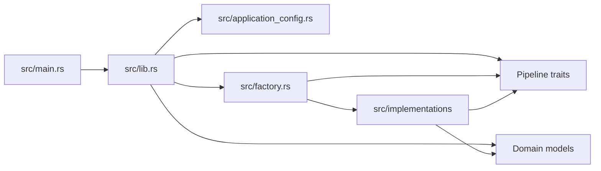
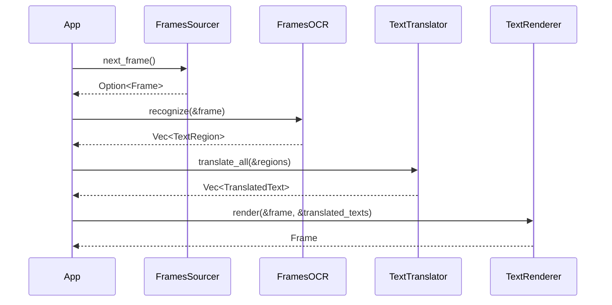
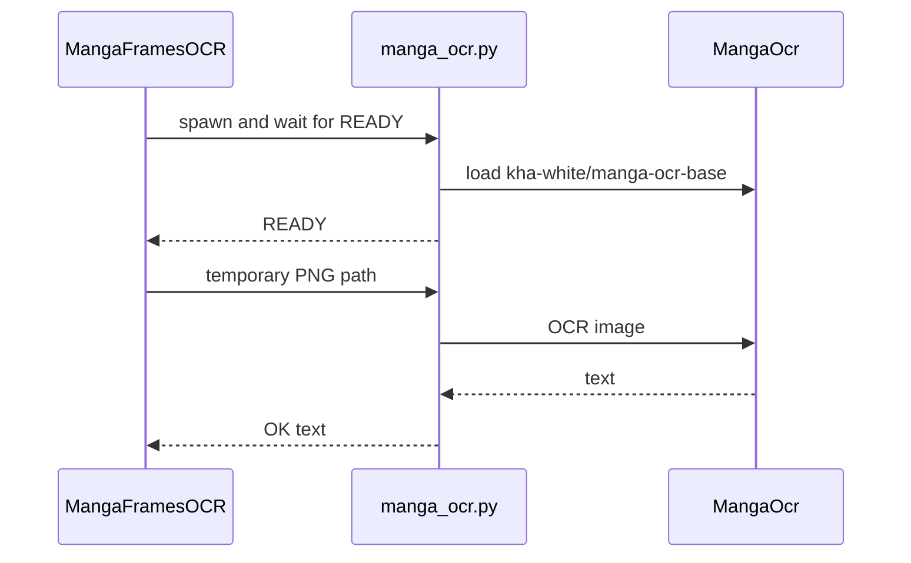

# Architecture

## Purpose

FramesTranslator is structured as a four-stage image translation pipeline:

1. `FramesSourcer` provides RGBA frames.
2. `FramesOCR` finds text regions in a frame.
3. `TextTranslator` translates recognized text.
4. `TextRenderer` draws translated regions onto a new frame.

The current repository provides the contracts, domain models, configuration, implementation factory, deterministic development backends, and integration tests. It does not yet provide production OCR, machine translation, or font rendering.

## Architectural style

The project separates four concerns:

- **Domain models** describe frames and text regions without depending on any backend.
- **Pipeline contracts** are Rust traits with typed errors.
- **Concrete implementations** adapt local resources to those contracts.
- **Composition** loads class names from `ApplicationConfig` and constructs the selected implementations through a factory.

The pipeline depends on traits. Concrete types are known only to the factory, `src/lib.rs`, and tests that intentionally exercise a specific implementation.



## Module layout

| Path | Responsibility |
| --- | --- |
| `src/frame.rs` | Named RGBA `Frame` model and `FrameError` |
| `src/frames_config.rs` | `FramesConfig` and named frame rectangles |
| `src/tests_config.rs` | `TestsConfig` and per-test configuration structs |
| `src/application_config.rs` | `ApplicationConfig` implementation selection and JSONC methods |
| `src/text_region.rs` | `Bounds`, `TextRegion`, and `TranslatedText` |
| `src/frames_sourcer.rs` | `FramesSourcer` contract and `FrameSourceError` |
| `src/frames_ocr.rs` | `FramesOCR` contract and `RecognitionError` |
| `src/text_translator.rs` | `TextTranslator` contract and `TranslationError` |
| `src/text_renderer.rs` | `TextRenderer` contract and `RenderingError` |
| `src/factory.rs` | Class-name based composition and `FactoryError` |
| `src/implementations/` | Concrete backends for the four contracts |
| `src/lib.rs` | Public module and re-export surface |
| `src/main.rs` | Binary entry point that runs the configured pipeline |

## Domain models

### Frame

`Frame` owns a name and a validated RGBA8 pixel buffer.

Invariants:

- Pixel data length equals `width * height * 4`.
- Multiplication overflow is rejected through `FrameError::DimensionsOverflow`.
- A buffer length mismatch is rejected through `FrameError::PixelBufferSizeMismatch`.

The type is immutable through its public read-only accessors. Renderers copy the buffer and return a new `Frame` instead of mutating the input.

### FramesConfig

`FramesConfig` holds a `frames` list of `NamedRect` values. Each `NamedRect` pairs a name with a `Bounds` rectangle. The configuration preserves order and does not perform additional rectangle validation.

### TestsConfig

`TestsConfig` groups a separate configuration struct for each test case. It exposes `ShadowrunCdTestConfig` for the gameplay menus, `ShadowrunDialogTestConfig` for the intro dialog box, and `ShadowrunStreetTestConfig` for the Shibuya street dialog box. Each owns a `FramesConfig` describing the expected detected frames, `BTreeMap` dictionaries of expected OCR lines under `expectedResultOCR` and expected translations under `expectedTranslationResult` keyed by expected frame name, and the renderer preview duration under `timeoutSeconds`. Additional test cases should add their own configuration struct rather than sharing one generic shape.

### Bounds

`Bounds` stores `x`, `y`, `width`, and `height`. `right()` and `bottom()` use saturating addition, so coordinate overflow cannot wrap. Bounds are not clamped to a frame; renderers validate containment before drawing.

### TextRegion and TranslatedText

`TextRegion` pairs recognized text with bounds. `TranslatedText` retains the original region and adds translated text. Retaining the source region lets the renderer preserve position and gives callers access to both the original and translated forms.

## Pipeline contracts

| Contract | Method | Ownership | Termination |
| --- | --- | --- | --- |
| `FramesSourcer` | `next_frame(&mut self) -> Result<Option<Frame>, FrameSourceError>` | Mutable source, owned frame | `None` |
| `FramesOCR` | `recognize(&self, &Frame) -> Result<Vec<TextRegion>, RecognitionError>` | Shared frame | Empty region list |
| `TextTranslator` | `translate(&mut self, &str) -> Result<String, TranslationError>` | Mutable translator | Error for unknown text |
| `TextRenderer` | `render(&self, &Frame, &[TranslatedText]) -> Result<Frame, RenderingError>` | Shared input, new frame | Returns a new frame |

`TextTranslator` also provides a default `translate_all` method that maps each `TextRegion` through `translate` and returns `Vec<TranslatedText>`.

The translator takes `&mut self` to allow stateful implementations such as caches or sessions. OCR and rendering take `&self` because they are modeled as read-only operations over their inputs.

All four traits are object-safe, allowing the factory and application to hold `Box<dyn Trait>` values.

## Data flow



The application owns orchestration. Individual stages do not call each other, which keeps them independently replaceable and testable.

## Configuration and composition

Implementation selection is defined by `ApplicationConfig`. The current test configuration is `test-case/tests-application-config.jsonc`:

```jsonc
{
  "framesSourcer": "FramesDetectorSourcer",
  "framesOcr": "MangaFramesOCR",
  "textTranslator": "ArgosTextTranslator",
  "textRenderer": "SdlThreeTextRenderer",
  "framesDetectionBackgroundColors": [0x000000],
  "framesDetectionTextColors": [0xfcfcfc, 0xffffff, 0xfcfcb4]
}
```

`ApplicationConfig` uses Serde with camelCase field names. `ApplicationConfig::from_jsonc` parses JSONC through `json5`; `ApplicationConfig::to_jsonc` emits pretty JSON through `serde_json`.

`src/factory.rs` is the composition root. Each factory function reads one implementation name from `ApplicationConfig` and constructs the matching implementation:

| Factory function | Configuration getter | Configuration key |
| --- | --- | --- |
| `create_frames_sourcer` | `frames_sourcer()` | `framesSourcer` |
| `create_frames_ocr` | `frames_ocr()` | `framesOcr` |
| `create_text_translator` | `text_translator()` | `textTranslator` |
| `create_text_renderer` | `text_renderer()` | `textRenderer` |

`ImageFramesSourcer` uses the fixed image `test-case/Shadowrun_02.png` and the frame definitions in `test-case/tests-config.jsonc` when created through the factory. The constructor `ImageFramesSourcer::open(path, frames_config)` remains available for explicit image paths and frame definitions.

`FramesDetectorSourcer` uses the fixed `Shadowrun_02.png` image when created through the factory and reads `framesDetectionBackgroundColors` and `framesDetectionTextColors` from `ApplicationConfig`. Both are arrays of 24-bit RGB integers; JSONC hexadecimal literals such as `0x000000` are accepted. A pixel matches a color set when it equals any color in that set. Color values outside `0xFFFFFF` are rejected through `FrameSourceError::InvalidColor`. Integration tests open `Shadowrun_01.png` and `Shadowrun_03.png` directly with the same configured color arrays.

The detector produces two frames for `Shadowrun_02.png` and one frame each for `Shadowrun_01.png` and `Shadowrun_03.png`. Integration tests validate them against the expected `frames` entries in `test-case/tests-config.jsonc` by order, name prefix, position, dimensions, and crop pixels. OCR and translation expectations are looked up by the expected frame name, so each panel and the dialog box are validated independently.

Because the application configuration remains focused on implementation selection and the two detector colors, other backend-specific settings are constants inside implementations rather than configuration values.

### Configuration serialization

`ApplicationConfig`, `TestsConfig`, and their nested configuration types derive Serde serialization and deserialization. All JSONC entry points use `json5`, which supports comments and trailing commas. Serialization uses `serde_json` and emits pretty JSON. `test-case/tests-application-config.jsonc` and `test-case/tests-config.jsonc` are the serialized representations of the current configurations.

`ShadowrunCdTestConfig` flattens its `FramesConfig`, so the JSONC shape is:

```jsonc
{
  "shadowrun_cd": {
    "frames": [
      {
        "name": "Actions Menu",
        "rect": { "x": 18, "y": 86, "width": 91, "height": 68 }
      },
      {
        "name": "Contacts",
        "rect": { "x": 146, "y": 86, "width": 75, "height": 68 }
      }
    ],
    "expectedResultOCR": {
      "Actions Menu": ["見る", "話す", "移動", "アイテム"],
      "Contacts": ["仲間", "通行人１", "通行人２", "通行人９"]
    },
    "expectedTranslationResult": {
      "Actions Menu": ["See", "Talk", "Contact Us", "Item."],
      "Contacts": ["Contact Us", "Traffic1.", "person 2.", "Traffic 9."]
    },
    "timeoutSeconds": 5
  },
  "shadowrun_dialog": {
    "frames": [
      {
        "name": "Dialog",
        "rect": { "x": 26, "y": 158, "width": 267, "height": 52 }
      }
    ],
    "expectedResultOCR": {
      "Dialog": ["意外に手ごたえのない", "連中だったわね"]
    },
    "expectedTranslationResult": {
      "Dialog": ["Unexpected", "It was a long time."]
    },
    "timeoutSeconds": 5
  },
  "shadowrun_street": {
    "frames": [
      {
        "name": "Street Dialog",
        "rect": { "x": 26, "y": 158, "width": 267, "height": 52 }
      }
    ],
    "expectedResultOCR": {
      "Street Dialog": ["渋谷は", "とてもきらびやかな街だ"]
    },
    "expectedTranslationResult": {
      "Street Dialog": ["Shibuya", "A very nice city"]
    },
    "timeoutSeconds": 5
  }
}
```

## Concrete implementations

| Type | Contract | Behavior | Limitations |
| --- | --- | --- | --- |
| `ImageFramesSourcer` | `FramesSourcer` | Decodes a PNG and extracts the named frame rectangles from `TestsConfig` | Single image, no video or directory input |
| `FramesDetectorSourcer` | `FramesSourcer` | Finds connected background-color components that contain text-color pixels and extracts each component as a frame | Exact color match and fixed size and density thresholds |
| `SyntheticFramesSourcer` | `FramesSourcer` | Yields two fixed `32x24` frames and then `None` | In-memory test data |
| `FixtureFramesOCR` | `FramesOCR` | Returns two fixed text regions | Does not inspect the frame |
| `MangaFramesOCR` | `FramesOCR` | Splits frames into detected text lines with horizontal ink padding and OCRs each line through a persistent `manga-ocr` Python worker | Japanese-focused model; requires `.venv`; threshold-based line detection |
| `DictionaryTextTranslator` | `TextTranslator` | Maps two fixed source strings to translated strings | Exact-match dictionary only |
| `ArgosTextTranslator` | `TextTranslator` | Sends JSONL requests to a persistent `argostranslate` Python worker | Defaults to Japanese to English; requires installed Argos language packages |
| `BlockTextRenderer` | `TextRenderer` | Fills each translated region with a fixed orange color | Draws blocks, not glyphs |
| `SdlThreeTextRenderer` | `TextRenderer` | Shows `test-case/Shadowrun_02.png`, blacks out the configured frame, draws translated lines, and waits for the window to close | Uses SDL's ASCII debug font and requires a display |

`ImageFramesSourcer` depends on the `image` crate with only the PNG feature enabled. `SdlThreeTextRenderer` uses vendored SDL3 3.4.20 libraries under `third-party/sdl3`; `build.rs` adds the import library path and copies `SDL3.dll` next to test and binary outputs.

`FramesDetectorSourcer` builds a mask of pixels matching the configured background color, traces four-connected components, and evaluates each component's bounding box. A bounding box becomes a frame when it is at least `16x16`, contains at least 16 text-color pixels, and is at least 50 percent background-color pixels. Accepted frames are sorted top-to-bottom and left-to-right, then cropped and named `Detected Frame {number}`. The Shadowrun CD sample yields the `Actions Menu` panel at `(18, 86, 91, 68)` and the `Contacts` panel at `(146, 86, 75, 68)`.

`SdlThreeTextRenderer` resolves a frame placement by matching the configured frame name first. Detector-generated names do not match the descriptive names in `tests-config.jsonc`, so the renderer falls back to exact frame dimensions. Equal-sized detected frames resolve to the first configured match.

`MangaFramesOCR` starts `.venv/Scripts/python.exe` with `scripts/manga_ocr_worker.py` and keeps the worker alive for the lifetime of the OCR instance. It detects horizontal text lines by luminance, crops each line to its horizontal ink extent with vertical and horizontal padding, encodes it to a temporary PNG, and reads the line text from stdout. Worker access is serialized by a mutex. Each recognized line becomes one `TextRegion` with bounds relative to the original frame; empty lines are omitted.



`ArgosTextTranslator` starts `.venv/Scripts/python.exe` with `scripts/argos_translate_worker.py ja en` and keeps the worker alive. Requests and responses are JSON lines, so translated text can contain whitespace without breaking the protocol. The default language pair is Japanese to English; `with_languages` accepts another installed pair. Short Japanese labels are retried with sentence punctuation when Argos returns an empty or unstable translation.

## Error strategy

Each layer has a typed error enum implementing `std::error::Error`:

| Error | Variants |
| --- | --- |
| `FrameError` | `DimensionsOverflow`, `PixelBufferSizeMismatch` |
| `FrameSourceError` | `Io`, `Decoding`, `RegionOutOfBounds`, `InvalidColor` |
| `RecognitionError` | `UnsupportedFrame`, `RecognitionFailed` |
| `TranslationError` | `Unavailable`, `InvalidResponse` |
| `RenderingError` | `RegionOutOfBounds`, `UnsupportedFrame`, `InvalidFrame`, `RenderingFailed` |
| `FactoryError` | `FrameSource`, `Recognition`, `Translation`, `Io`, `TestsConfig`, `UnknownImplementation` |

Errors are propagated with `?`. `FactoryError` preserves source errors where a dedicated variant exists. No stage panics on malformed external input; invalid dimensions, missing configuration, unknown class names, and out-of-bounds rendering are represented as errors.

## Testing architecture

Integration tests live in `tests/`:

- `tests/support/mod.rs` loads `test-case/tests-application-config.jsonc` from `CARGO_MANIFEST_DIR`.
- `frames_sourcer_test.rs`, `frames_ocr_test.rs`, `text_translator_test.rs`, and `text_renderer_test.rs` obtain concrete types through the factory.
- `frames_sourcer_test.rs` validates both detected frames against the expected names, positions, dimensions, and crop pixels from `tests-config.jsonc`.
- `frames_ocr_test.rs` validates four OCR lines per detected frame using the `expectedResultOCR` dictionary keyed by expected frame name.
- `shadowrun_cd_pipeline_test.rs` validates four translations per detected frame using the `expectedTranslationResult` dictionary and renders both frames.
- `frames_detector_sourcer_test.rs` opens `test-case/Shadowrun_01.png`, `test-case/Shadowrun_02.png`, and `test-case/Shadowrun_03.png` directly with the configured detection colors, asserts the detected frame order, dimensions, and pixel fidelity, and verifies factory selection of `FramesDetectorSourcer`.
- `shadowrun_dialog_pipeline_test.rs` runs the `Shadowrun_01.png` dialog through detection, OCR, translation, and `BlockTextRenderer`, asserting both recognized lines, both translations, and the rendered blocks.
- `shadowrun_street_pipeline_test.rs` runs the `Shadowrun_03.png` street dialog through the same pipeline and asserts its two recognized lines, translations, and rendered blocks.
- `application_config_test.rs` loads and validates the application configuration and round-trips it through JSONC.
- `tests_config_test.rs` loads `test-case/tests-config.jsonc`, validates its contents, and round-trips it through JSONC serialization and deserialization.

Coverage includes:

- PNG decoding, detected frame dimensions and crop pixel fidelity,
- color-based frame detection of both menu panels and the intro and street dialog boxes, reading-order output, multi-color matching, detection thresholds, and invalid color rejection,
- source termination,
- exact per-frame OCR regions and frame containment,
- Manga OCR protocol response parsing, line segmentation, and real `"Actions Menu"`, `"Contacts"`, `"Dialog"`, and `"Street Dialog"` text extraction,
- Argos Translate protocol parsing and Japanese to English translation,
- full Shadowrun CD source to OCR to translation pipeline over both detected frames,
- full Shadowrun intro and street dialog detection to OCR to translation to block-rendering pipelines,
- SDL preview timeout behavior,
- single and batch translation,
- unknown dictionary entries,
- rendered region color, unchanged frame dimensions,
- out-of-bounds region rejection,
- application configuration loading and round-trip serialization,
- test configuration loading and round-trip serialization.

Tests run with `cargo test`. Linting uses `cargo clippy --all-targets -- -D warnings`; formatting uses `cargo fmt --check`.

## Design decisions

### Trait objects at composition boundaries

Traits keep the pipeline independent of backends. Factory functions return `Box<dyn Trait>` because `ApplicationConfig` selects implementations at runtime and each stage has a single active backend. Static generics would require the selection to be known at compile time.

### Synchronous contracts

The current contracts are synchronous and single-threaded. This keeps the pipeline simple while backend behavior is still being established. Async OCR or network translation can be added later through new traits or a deliberate contract change.

### Owned frames

`Frame` owns its pixel buffer. Sources transfer ownership to callers, and renderers return new frames. This avoids hidden aliasing and keeps frame history straightforward at the cost of copying the buffer during rendering.

### Typed errors per stage

Each stage has an error type specific to its failure modes. A shared pipeline error would reduce type precision and make backend-specific failures harder to distinguish.

### Class names only in application configuration

Configuration is limited to selecting implementations. This keeps configuration files stable and free of secrets or backend-specific options. The tradeoff is that concrete backends currently need constructor defaults for settings such as file paths, colors, and fixture data.

## Extension guide

To add a backend:

1. Implement the relevant trait under `src/implementations/`.
2. Export the type from `src/implementations/mod.rs`.
3. Add a match arm in the corresponding factory function in `src/factory.rs`.
4. Select the class name in `test-case/tests-application-config.jsonc`.
5. Add an integration test that exercises the contract.

Production backends will likely need additional design work:

- OCR: a local OCR engine or an external service adapter.
- Translation: a service adapter with credentials and rate-limit handling.
- Rendering: glyph layout, font loading, text fitting, and background preservation.
- Source: video decoding, directory traversal, and frame timestamps.

If backends require configurable paths, credentials, or tuning parameters, the configuration model should be extended deliberately rather than adding ad hoc file reads inside implementations.

## Current limitations

- `src/main.rs` runs the configured source, OCR, translation, and rendering pipeline.
- OCR and translation use local Python models with model-dependent quality.
- `BlockTextRenderer` draws colored blocks; `SdlThreeTextRenderer` uses SDL's ASCII debug font.
- Only PNG input is supported.
- Frames are processed synchronously and fully in memory.
- `ApplicationConfig` supports implementation selection plus `FramesDetectorSourcer` colors.
- `FramesDetectorSourcer` requires exact matches against the configured background and text color arrays and uses fixed detection thresholds.
