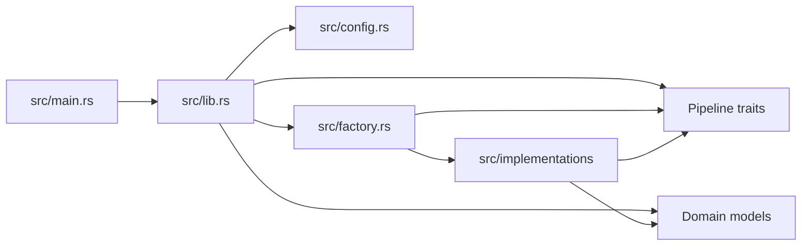
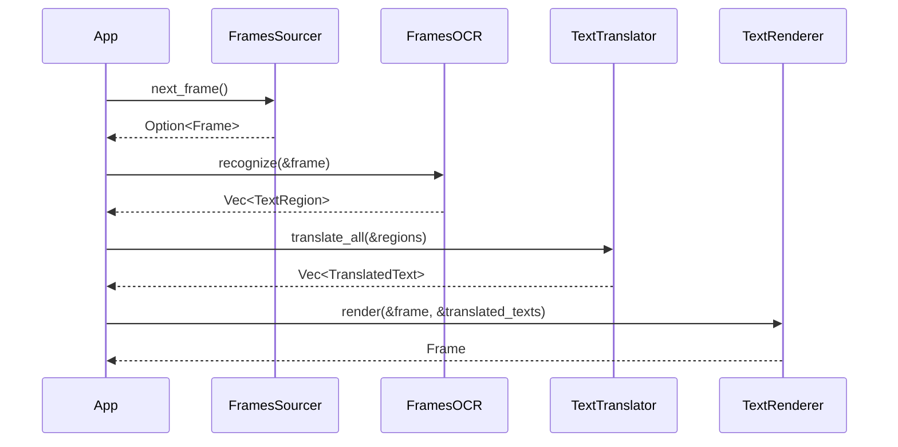

# Architecture

## Purpose

FramesTranslator is structured as a four-stage image translation pipeline:

1. `FramesSourcer` provides RGBA frames.
2. `FramesOCR` finds text regions in a frame.
3. `TextTranslator` translates recognized text.
4. `TextRenderer` draws translated regions onto a new frame.

The current repository provides the contracts, domain models, configuration, implementation factory, deterministic development backends, and integration tests. It does not yet provide production OCR, machine translation, or font rendering.

## Architectural style

The project separates four concerns:

- **Domain models** describe frames and text regions without depending on any backend.
- **Pipeline contracts** are Rust traits with typed errors.
- **Concrete implementations** adapt local resources to those contracts.
- **Composition** loads class names from `.env` and constructs the selected implementations through a factory.

The pipeline depends on traits. Concrete types are known only to the factory, `src/lib.rs`, and tests that intentionally exercise a specific implementation.



## Module layout

| Path | Responsibility |
| --- | --- |
| `src/frame.rs` | RGBA `Frame` model and `FrameError` |
| `src/text_region.rs` | `Bounds`, `TextRegion`, and `TranslatedText` |
| `src/frames_sourcer.rs` | `FramesSourcer` contract and `FrameSourceError` |
| `src/frames_ocr.rs` | `FramesOCR` contract and `RecognitionError` |
| `src/text_translator.rs` | `TextTranslator` contract and `TranslationError` |
| `src/text_renderer.rs` | `TextRenderer` contract and `RenderingError` |
| `src/config.rs` | Typed `.env` reader and `ConfigError` |
| `src/factory.rs` | Class-name based composition and `FactoryError` |
| `src/implementations/` | Concrete backends for the four contracts |
| `src/lib.rs` | Public module and re-export surface |
| `src/main.rs` | Binary entry point, currently empty |

## Domain models

### Frame

`Frame` owns a validated RGBA8 pixel buffer.

Invariants:

- Pixel data length equals `width * height * 4`.
- Multiplication overflow is rejected through `FrameError::DimensionsOverflow`.
- A buffer length mismatch is rejected through `FrameError::PixelBufferSizeMismatch`.

The type is immutable through its public read-only accessors. Renderers copy the buffer and return a new `Frame` instead of mutating the input.

### Bounds

`Bounds` stores `x`, `y`, `width`, and `height`. `right()` and `bottom()` use saturating addition, so coordinate overflow cannot wrap. Bounds are not clamped to a frame; renderers validate containment before drawing.

### TextRegion and TranslatedText

`TextRegion` pairs recognized text with bounds. `TranslatedText` retains the original region and adds translated text. Retaining the source region lets the renderer preserve position and gives callers access to both the original and translated forms.

## Pipeline contracts

| Contract | Method | Ownership | Termination |
| --- | --- | --- | --- |
| `FramesSourcer` | `next_frame(&mut self) -> Result<Option<Frame>, FrameSourceError>` | Mutable source, owned frame | `None` |
| `FramesOCR` | `recognize(&self, &Frame) -> Result<Vec<TextRegion>, RecognitionError>` | Shared frame | Empty region list |
| `TextTranslator` | `translate(&mut self, &str) -> Result<String, TranslationError>` | Mutable translator | Error for unknown text |
| `TextRenderer` | `render(&self, &Frame, &[TranslatedText]) -> Result<Frame, RenderingError>` | Shared input, new frame | Returns a new frame |

`TextTranslator` also provides a default `translate_all` method that maps each `TextRegion` through `translate` and returns `Vec<TranslatedText>`.

The translator takes `&mut self` to allow stateful implementations such as caches or sessions. OCR and rendering take `&self` because they are modeled as read-only operations over their inputs.

All four traits are object-safe, allowing the factory and application to hold `Box<dyn Trait>` values.

## Data flow



The application owns orchestration. Individual stages do not call each other, which keeps them independently replaceable and testable.

## Configuration and composition

`.env` contains only implementation class names:

```env
FRAMES_SOURCER=ImageFramesSourcer
FRAMES_OCR=FixtureFramesOCR
TEXT_TRANSLATOR=DictionaryTextTranslator
TEXT_RENDERER=BlockTextRenderer
```

`Config::load` reads and parses the file directly. It does not read process environment variables and does not use a dotenv dependency. The parser:

- ignores blank lines and lines beginning with `#`,
- splits entries on the first `=`,
- trims surrounding whitespace and quote characters,
- rejects malformed lines and missing keys.

`src/factory.rs` is the composition root. Each factory function reads one class name and constructs the matching implementation:

| Factory function | Environment key |
| --- | --- |
| `create_frames_sourcer` | `FRAMES_SOURCER` |
| `create_frames_ocr` | `FRAMES_OCR` |
| `create_text_translator` | `TEXT_TRANSLATOR` |
| `create_text_renderer` | `TEXT_RENDERER` |

`ImageFramesSourcer` uses the fixed file `test-case/Shadowrun_02.png` when created through the factory. The constructor `ImageFramesSourcer::open(path)` remains available for explicit paths. Because `.env` is restricted to class names, backend-specific settings are currently constants inside implementations rather than configuration values.

## Concrete implementations

| Type | Contract | Behavior | Limitations |
| --- | --- | --- | --- |
| `ImageFramesSourcer` | `FramesSourcer` | Decodes a PNG to RGBA at construction and yields one frame | Single image, no video or directory input |
| `SyntheticFramesSourcer` | `FramesSourcer` | Yields two fixed `32x24` frames and then `None` | In-memory test data |
| `FixtureFramesOCR` | `FramesOCR` | Returns two fixed text regions | Does not inspect the frame |
| `DictionaryTextTranslator` | `TextTranslator` | Maps two fixed source strings to translated strings | Exact-match dictionary only |
| `BlockTextRenderer` | `TextRenderer` | Fills each translated region with a fixed orange color | Draws blocks, not glyphs |

`ImageFramesSourcer` depends on the `image` crate with only the PNG feature enabled.

## Error strategy

Each layer has a typed error enum implementing `std::error::Error`:

| Error | Variants |
| --- | --- |
| `FrameError` | `DimensionsOverflow`, `PixelBufferSizeMismatch` |
| `FrameSourceError` | `Io`, `Decoding` |
| `RecognitionError` | `UnsupportedFrame`, `RecognitionFailed` |
| `TranslationError` | `Unavailable`, `InvalidResponse` |
| `RenderingError` | `RegionOutOfBounds`, `UnsupportedFrame`, `InvalidFrame` |
| `ConfigError` | `Io`, `MalformedLine`, `MissingKey` |
| `FactoryError` | `Config`, `FrameSource`, `UnknownImplementation` |

Errors are propagated with `?`. `FactoryError` preserves source errors where a dedicated variant exists. No stage panics on malformed external input; invalid dimensions, missing configuration, unknown class names, and out-of-bounds rendering are represented as errors.

## Testing architecture

Integration tests live in `tests/`:

- `tests/support/mod.rs` loads the repository `.env` from `CARGO_MANIFEST_DIR`.
- `frames_ocr_test.rs`, `text_translator_test.rs`, and `text_renderer_test.rs` obtain concrete types through the factory.
- `frames_sourcer_test.rs` instantiates `ImageFramesSourcer` directly with `test-case/Shadowrun_02.png` to verify decoding and frame exhaustion.

Coverage includes:

- PNG decoding, dimensions, RGBA buffer size, and non-empty pixel data,
- source termination,
- exact OCR regions and frame containment,
- single and batch translation,
- unknown dictionary entries,
- rendered region color, unchanged frame dimensions,
- out-of-bounds region rejection.

Tests run with `cargo test`. Linting uses `cargo clippy --all-targets -- -D warnings`; formatting uses `cargo fmt --check`.

## Design decisions

### Trait objects at composition boundaries

Traits keep the pipeline independent of backends. Factory functions return `Box<dyn Trait>` because `.env` selects implementations at runtime and each stage has a single active backend. Static generics would require the selection to be known at compile time.

### Synchronous contracts

The current contracts are synchronous and single-threaded. This keeps the pipeline simple while backend behavior is still being established. Async OCR or network translation can be added later through new traits or a deliberate contract change.

### Owned frames

`Frame` owns its pixel buffer. Sources transfer ownership to callers, and renderers return new frames. This avoids hidden aliasing and keeps frame history straightforward at the cost of copying the buffer during rendering.

### Typed errors per stage

Each stage has an error type specific to its failure modes. A shared pipeline error would reduce type precision and make backend-specific failures harder to distinguish.

### Class names only in `.env`

Configuration is limited to selecting implementations. This keeps environment files stable and free of secrets or backend-specific options. The tradeoff is that concrete backends currently need constructor defaults for settings such as file paths, colors, and fixture data.

## Extension guide

To add a backend:

1. Implement the relevant trait under `src/implementations/`.
2. Export the type from `src/implementations/mod.rs`.
3. Add a match arm in the corresponding factory function in `src/factory.rs`.
4. Select the class name in `.env` and `.env.example`.
5. Add an integration test that exercises the contract.

Production backends will likely need additional design work:

- OCR: a local OCR engine or an external service adapter.
- Translation: a service adapter with credentials and rate-limit handling.
- Rendering: glyph layout, font loading, text fitting, and background preservation.
- Source: video decoding, directory traversal, and frame timestamps.

If backends require configurable paths, credentials, or tuning parameters, the configuration model should be extended deliberately rather than adding ad hoc environment reads inside implementations.

## Current limitations

- `src/main.rs` is empty; there is no CLI or end-to-end application yet.
- OCR and translation implementations are deterministic fixtures, not real services.
- Rendering produces colored blocks rather than text glyphs.
- Only PNG input is supported.
- Frames are processed synchronously and fully in memory.
- `.env` supports implementation selection only.
